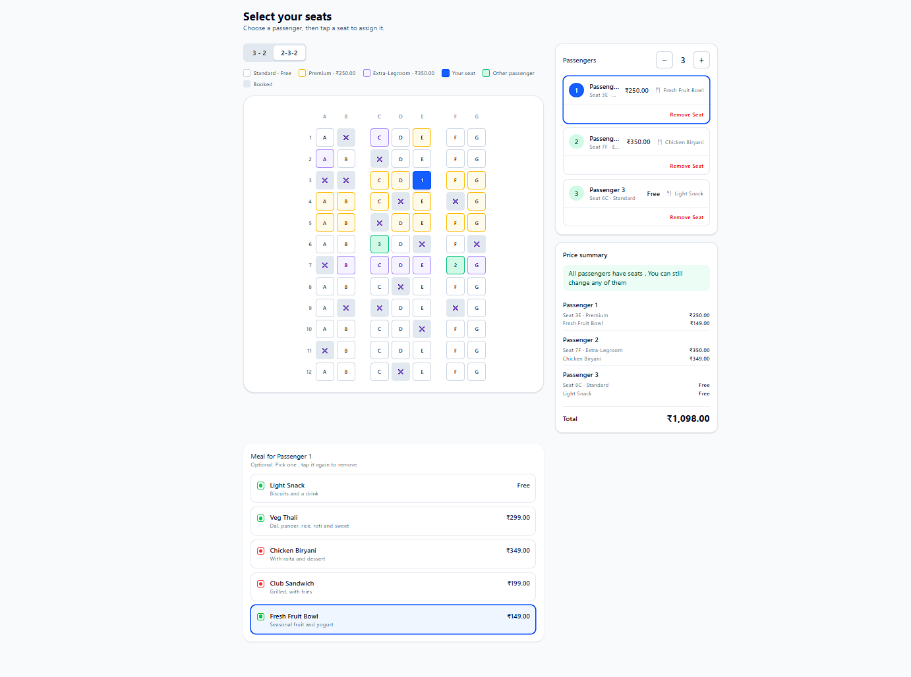
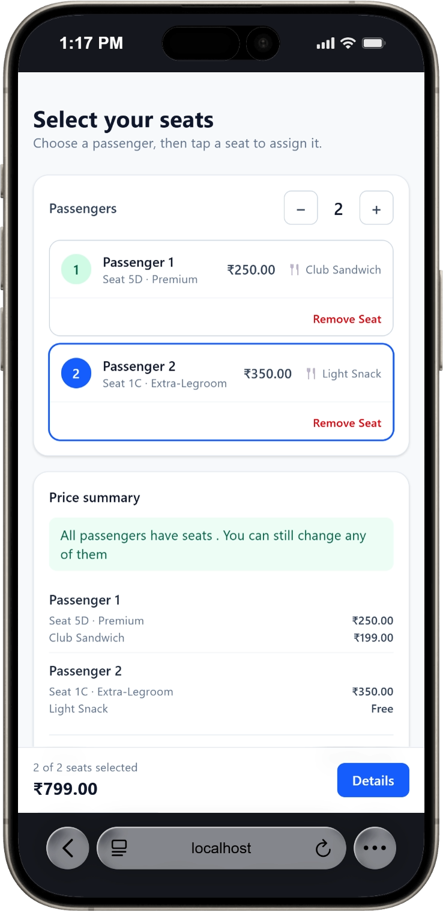

# Flight Seat Selection

A seat-selection and passenger-management interface built with React, TypeScript and Tailwind CSS.

**Live demo:** https://flight-seat-selection-eta.vercel.app/

## Features

- 1–6 passengers, with fast switching between them
- Two aircraft layouts (3-2 and 2-3-2), rendered from one set of components
- Seat states: available, booked, selected (active passenger), taken (another passenger)
- Seat categories and prices: Standard (free), Premium (₹250), Extra Legroom (₹350)
- Assign, change and remove seats, with feedback for invalid actions
- Live price breakdown and total, with a sticky total bar on mobile
- Meal selection per passenger, free and paid 
- Loading, error and empty states; error boundary; responsive down to 320px

## Run locally

```bash
pnpm install
pnpm  dev      # development server
pnpm test         # unit tests
pnpm build    # type-check and production build
```

To see the error state, open `/?seatmap-error`. The first load fails and "Try again" succeeds.

## State management

State lives in one `useReducer` inside a Context provider (`BookingProvider`).

```ts
state = {
  layout: '3-2' | '2-3-2',
  passengers: [{ id, name, seatId, mealId }],
  activePassengerId: string,
  notice: { type, message } | null,
}
```

**Seat ownership is stored on the passenger (`passenger.seatId`), and everything else is derived.**
Whether a seat is taken, who holds it, each passenger's charges and the total are all computed
from `passengers` during render. Nothing is stored twice, so the UI cannot get out of sync, and
the total updates immediately on every change.

All changes go through typed actions (`ASSIGN_SEAT`, `REMOVE_SEAT`, `SET_LAYOUT`, `SET_MEAL`, ...).
The reducer is pure and unit tested. Components are presentational where possible: `Seat` and
`SeatRow` receive props, and only container components read the context.


## Seat assignment logic

`ASSIGN_SEAT` is a small decision tree:

1. Seat does not exist in the current layout → error notice
2. Seat is booked → error notice
3. Seat is held by a different passenger → error notice (no duplicates possible)
4. Seat is held by the active passenger → toggle it off (remove)
5. Otherwise → assign it, replacing any previous seat (change)

- **One seat per passenger** is guaranteed by the data shape: there is only one `seatId` field.
- **Switching passengers** only changes `activePassengerId`, so earlier assignments are kept.
- **Auto-advance:** after a passenger's *first* seat, the app moves to the next passenger without one.
  Changing an existing seat does not advance.
- **Switching layouts** keeps assignments that still exist (seats A–E exist in both layouts),
  unassigns the rest and shows a notice.

## Layouts and seat data

A layout is data: an array of column groups, e.g. `[['A','B'], ['C','D','E'], ['F','G']]`.
`generateSeatRows(layout)` builds the rows from it, and the aisle is the gap between groups.
Adding a new layout means adding one config entry.

Seat categories come from rules (exit row, forward cabin) plus explicit overrides, which reproduce
the sample data from the brief exactly. Booked seats are a mock list.

## Pricing

`getPassengerCharges` returns seat price, meal price and subtotal for each passenger, and
`getTotal` sums them. Free items show "Free", while a total of zero shows "₹0".

## Notes and trade-offs

- The brief's 2-3-2 example lists `A B D E F G H` (7 seats, no C). I used the standard `A B | C D E | F G`.
- Loading is simulated (`src/api/mockSeatApi.ts`) on first load and retry only. Layout switches are
  instant because the reducer updates synchronously. Replacing the mock with a real API means changing that one file.
- Seats are 32px on phones, below the usual 44px touch-target guidance, so that a 7-column row fits
  a 375px screen. Confirmation toasts reduce the cost of a mis-tap.
- No backend, persistence or real booking, as specified.

## Project structure

```
src/
  api/         mock seat-map fetch
  components/  UI (SeatMap, PassengerList, MealPicker, PriceSummary, ...)
  context/     BookingContext, BookingProvider
  data/        layouts, seats, meals
  hooks/       useBookingSummary, useSeatMapLoader
  reducer/     bookingReducer (+ tests)
  types/       shared types
  utils/       pricing, seat helpers (+ tests)
```

## ScreenShots


